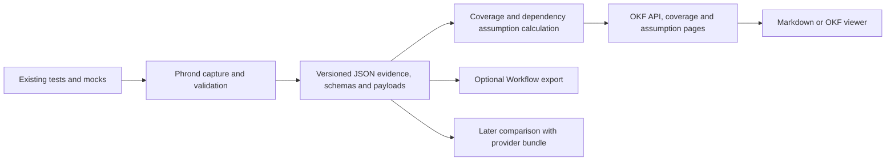

# OKF bundle output: design and implementation handoff

Status: core bundle migration implemented in this checkout, pending commit;
the bundled HTML viewer is the subsequent viewing decision. Postman export was
removed by a separate product decision.
Written and revised: 2026-09-28. Repository inspected at `bb7eb39`.

Use this document to resume implementation. It records the product direction,
format decisions, migration work, and acceptance criteria. The checklist below
is a design record, not a live progress tracker; consult the current code and
the implementation notes at the end of this document.

The revised storage decision supersedes the earlier draft: **versioned Phrond
JSON evidence is authoritative; every OKF Markdown page is a generated view**.
Both live in one portable output bundle. Implement immutable per-attempt JSON
files, not a shared JSONL log. Do not implement the earlier design in which
frontmatter held canonical HTTP interactions or every exchange required its
own Markdown concept.

## 1. Product outcome

**Instrument existing tests and route traffic through Phrond → run the tests →
get an OKF bundle describing your API and the dependency behaviour your tests
used.**

The bundle is the default persistent capture output and the published coverage
report. People and agents can browse its generated OKF pages. Deterministic
readers, exports, and future repository comparison tools consume its versioned
JSON evidence directly. Workflow and generated OpenAPI remain explicit exports.

Decisions for the first implementation:

- Write one self-contained bundle per capture run, with an OKF entry point and
  JSON evidence, schema snapshots, and payload attachments inside it. Stop
  writing loose per-test YAML artifacts or requiring their original directory.
- Retain the in-memory capture model and the existing proxy, tracing, redaction,
  schema validation, test outcome, and drain behaviour.
- Generate readable coverage, API/operation, dependency-assumption, and test
  pages. Group dependency observations by operation and show interactions within
  test pages. Do not require one Markdown file per interaction or assumption.
- Preserve exact retained evidence in the bundle, including non-text bodies,
  trailers, truncation, validation results, and uncertain correlation.
- Generate the bundle deterministically in code. An LLM, cloud account, and
  running documentation service are not prerequisites.
- Generate an offline HTML dashboard inside the bundle from the same verified
  evidence snapshot as the OKF pages. Keep Workflow and standalone HTML files
  as explicit exports; neither is produced outside the bundle by default.
- Keep OpenAPI generation supported as an explicit operation. Keep
  the existing Workflow exporter opt-in during this migration; removing it is
  a separate decision and is not required for OKF adoption.
- Include the evidence and identity needed for later repository comparisons.
  The initial bundle release does not need a production comparison engine.

Users keep their existing HTTP clients, test assertions, fixtures, and mock
servers. The integration still requires capture routing and test lifecycle
instrumentation. Shared-SUT parallel capture still requires standard trace
propagation; serial fallback remains available. There is no new mandatory
application instrumentation or Phrond-specific assertion API.

## 2. What an assumption means

An observed dependency assumption means: **this test exercised the consumer
while this request and response passed between it and a dependency**. When the
registered upstream is a mock, that is evidence of the mocked behaviour the
test used.

It does not establish which response fields the consumer read or asserted,
that every captured field is required, or that the provider actually behaves
that way. Do not recreate `assertDependency`, infer required fields from
presence, or silently generalize one example into a contract.

For a provider repository, inbound test→SUT exchanges supply observed provider
behaviour. A passing attempt shows behaviour exercised in that test environment;
it does not prove every response field was independently asserted or that a
deployed service has the same revision.

Store these distinctions explicitly:

| Evidence | Meaning |
| --- | --- |
| API operation in a supplied schema | Declared API surface at a particular schema version |
| Inbound interaction | Observed SUT behaviour in a test attempt |
| Outbound interaction | Observed dependency behaviour used by the SUT |
| Dependency assumption | A particular outbound example, linked to its attempt, operation, and evidence |
| Schema validation | Conformance checks against the pinned schema, with checked and skipped portions |
| Test outcome | The runner's final outcome, including capture and validation failures |
| Provider comparison | A later check against an explicitly identified provider bundle |

Dependency registration gains optional `upstream_kind: mock | service | unknown`.
Default to `unknown`; a localhost URL is not proof that the upstream is a mock.
The provided SUT also records a declared target kind, defaulting to `unknown`.
Keep direction, declared target kind, and verification independent.

## 3. Standard and Phrond profile

Target [Open Knowledge Format v0.2](https://github.com/GoogleCloudPlatform/open-knowledge-format/blob/ad30107c/SPEC.md), reviewed at revision `ad30107c`.
OKF supplies the document and
provenance conventions. Phrond supplies the HTTP evidence schema and comparison
semantics; generic OKF conformance alone does not establish those semantics.

OKF concepts are Markdown documents with YAML frontmatter and a `type`.
Additional fields are permitted. Concept IDs follow document paths. `index.md`
and `log.md` are reserved; keep indexes in the prescribed listing form, with
only `okf_version: "0.2"` in the root index's optional frontmatter. Use
`sources` and `generated` for provenance. Put Phrond's report data in its own
namespace; do not repurpose OKF lifecycle `status` as a test result. OKF's
`verified` describes verification of a concept, so do not populate it merely
because a captured test passed. Refer to the specification for full rules.

Define two independently versioned contracts:

| Contract | Purpose | Proposed documentation/schema |
| --- | --- | --- |
| Phrond evidence 1.0 | Canonical run inventory, attempts, interactions, schema/body references and provenance | `docs/bundle-evidence.md`, `docs/bundle-evidence.schema.json` |
| Phrond OKF profile 1.0 | Generated concept metadata, summaries, navigation and evidence pointers | `docs/okf-profile.md`, `docs/okf-profile.schema.json` |

The JSON Schema for evidence defines both the run
and attempt records. Markdown structure can evolve without changing evidence
identity or making machine consumers migrate to a new storage representation.

Every Phrond concept has:

- `type`, `title`, a short `description`, and `generated: {by, at}`.
- `phrond.profile_version: "1.0"` and a document-specific `phrond.kind`.
- Run/snapshot identity and structured evidence pointers under `phrond`;
  ordinary Markdown links in the body for human/OKF navigation.
- `sources` pointing to supporting concept documents or schema snapshots where
  applicable. Generated narrative must not introduce additional facts.

The evidence reader validates JSON and references without opening any Markdown.
Unknown optional evidence fields remain readable; unsupported evidence major
versions, duplicate keys/IDs, corrupt records, and missing required attachments
fail with useful integrity errors. Missing evidence is never an empty successful
capture. Preserve numeric and null/empty semantics when decoding and re-encoding.

The separate view validator checks generated frontmatter with a YAML parser,
required profile fields, and links. Unsupported view profiles or missing pages
do not block evidence reading, Workflow export, or view regeneration. The OKF
profile requires resolvable generated links beyond generic OKF conformance.
Ignore unrelated team-authored concepts and preserve unknown extensions.
Rebuilding views replaces only documented Phrond-owned generated paths; it must
not recursively delete team-authored documents or unrecognized files.

YAML frontmatter remains part of the format. The change removes Phrond's loose
YAML capture files, not YAML syntax inside Markdown or optional OpenAPI exports.

## 4. Bundle layout and source of truth

The output root defaults to `./artifacts`. Each runtime-owned capture run gets
a new `<run-id>` child directory; print and return that exact bundle path.
Keep the user's configured root rather than silently moving their artifacts.

```text
artifacts/<run-id>/
  index.md                         # Entry point and links
  run.md                           # Generated run/provenance/status overview
  coverage.md                      # Generated coverage summary and definitions
  apis/
    index.md
    <api-key>/
      api.md                       # Provided API and schema versions
      operations/<operation-key>.md
  dependencies/
    index.md
    <api-key>/
      api.md                       # Dependency identity, kind, schemas, coverage
      operations/<operation-key>.md # Grouped dependency assumptions and examples
  tests/
    index.md
    <attempt-id>.md                # Generated test page with interaction sections
  evidence/
    run.json                       # Authoritative run state and committed inventory
    attempts/<attempt-id>.json      # Immutable attempt with all of its interactions
  schemas/<schema-set-hash>/
    manifest.json                  # Deterministic schema-set inventory/hashes
    ...                            # Pinned OpenAPI JSON documents and referenced files
  payloads/<sha256>.bin             # Retained body bytes, deduplicated after redaction
```

Only `evidence/run.json`, its committed attempt JSON files, schema snapshots,
and referenced payloads are authoritative capture records. **All Phrond-generated
Markdown, including test and run pages, is disposable and rebuildable.** Preserve
team-authored documents as described in section 3. Deleting every generated
`.md` file must leave capture analysis and Workflow export working;
regeneration must restore the same semantic report using only the bundle.

Use one JSON document per completed attempt, with all of that attempt's flow
records inside it. This matches current teardown boundaries and makes atomic
writes, retries, and recovery straightforward. Do not introduce a shared JSONL
append log, a database, or a new event-stream protocol in this implementation.

`evidence/run.json` stores `evidence_version: "1.0"`, `run_id`, `revision`,
run state/times, identity/provenance, pending registrations, and committed
`{attempt_id, path, sha256}` records. Include configured API/schema-set references
so zero-traffic runs can still describe their declared surface. Each attempt
JSON has its own
`evidence_version`, `run_id`, `attempt_id`, original testcase metadata, schema
references, interactions, validation, and capture diagnostics. Body/schema
references are bundle-root-relative paths with hashes; they never rely on the
location of a Markdown page. Reject conflicting embedded/manifest identities.

Generated summaries and page bodies share one calculation. Record
`phrond.snapshot_revision` and `phrond.run_id` on derived concepts so readers
can recognize a stale view. Never read those cached summaries as input to an
authoritative calculation or write manual Markdown edits back into evidence.

The page's revision identifies the source snapshot used to render that page,
not a requirement that all pages always have the latest global revision. An
unchanged test page remains valid for its immutable attempt; an unaffected API
page may retain an older revision. Refresh pages when their inputs change,
including global run/coverage pages on relevant run changes. An explicit full
rebuild renders all pages against one inventory snapshot. Do not rebuild every
payload preview just because another test increments the run revision.

Determinism means identical committed evidence and generation settings produce
identical semantic data, ordering, links, and payload hashes. Allocate IDs once
and persist them. Derive `generated.at` from the source revision's recorded time
rather than the time someone reruns a report command. Independent test runs
naturally have different run IDs, timestamps, and trace IDs.



Do not make the existing aggregate `coverage.Report` the capture serializer.
It omits some original capture detail. The bundle reader must reconstruct the
complete capture model from JSON evidence before computing summaries or
exports. Internal Go types may still be named `artifact` initially; a package
rename is not needed to deliver this change.

### Generated views

These concepts summarize canonical evidence; their frontmatter is not another
capture store. Keep identity, useful summary fields, and typed evidence pointers
in the Phrond namespace. Put readable explanations and navigation in the body.

| Concept type / `phrond.kind` | Derived content |
| --- | --- |
| Capture Run / `run` | Run identity, versions, times, open/complete/interrupted state, committed/pending counts, provided API and source provenance; link to `evidence/run.json` |
| Coverage Summary / `coverage` | Counts by API and schema version, metric definitions, run state, snapshot revision, unmatched flows and diagnostics |
| API / `api` | Provided/dependency role, stable service identity, declared target kind, schema set references and operation inventory |
| API Operation / `operation` | API identity, schema version, method, path template, optional OpenAPI operationId, observation counts, attempt/evidence links |
| Test Attempt / `attempt` | Case identity and metadata, outcome, timing, trace/capture/validation diagnostics; one section per interaction with bounded previews and links to raw evidence |
| Dependency Assumptions / `assumptions` | One dependency-operation group: distinct outbound observations, counts, scenario/outcome/capture-quality summaries, provider check initially `not_checked`, and evidence pointers |

Generate dependency assumption pages at
`dependencies/<api-key>/operations/<operation-key>.md`, one per operation and
schema set. There is no separate assumption document or concept for every
outbound flow, and no separate HTTP Interaction document. Each JSON attempt
retains every original exchange; grouping pages must never merge its evidence.

Document count should grow with attempts, APIs, and operations, not with every
exchange. On operation pages show total counts, a deterministic selection of
at most three example previews, and an evidence index linking all observations
to their test pages and JSON records. Label previews as a sample. Test pages
provide a section for every interaction, including unmatched traffic. Page
grouping and preview limits must not hide failures or discard scenarios.

### Body storage and fidelity

JSON interaction records preserve multi-value headers and trailers, HTTP
method/URL/status, timestamps, trace IDs, correlation labels, parent links,
transport errors, and request/response validation details. Preserve arbitrary
test metadata and all current schema validation diagnostics as well.

For every body, retain its current representation and metadata: encoding,
content encoding, truncation, original size, and decoded representation when
available. Write its retained bytes to a content-addressed attachment and
store `{path, sha256, retained_bytes}` alongside that metadata. Convert existing
base64 body storage to attachment bytes and reconstruct it on read. Distinguish
an absent body, an empty body, and an unavailable/incomplete body. Do not claim
to preserve original compressed wire bytes if the current capture model only
retains a decompressed representation.

Hash only the retained, redacted representation. Redaction must happen before
JSON records, attachments, matching signatures, frontmatter, or body previews
are written.
Preserve the redaction rules/masks so a comparison can recognize unknown values;
equal redaction placeholders must never count as equal original values.

Interaction sections on test pages show headers, status, correlation, and a
bounded text/JSON preview (initial default 4 KiB), linking to the attachment
and attempt JSON for more. Preview
limits do not further truncate the underlying captured evidence. Render binary
bodies as size/encoding plus attachment links. All payload content is escaped
as data, including Markdown delimiters, links, HTML, and code fences.

### Schema snapshots

Freeze each configured schema and its transitive references before admitting
the attempt's traffic. Reuse that snapshot for validation and coverage so
editing a local file or changing a schema URL cannot change a finished run.
Use a deterministic manifest of snapshot paths and content hashes to identify
the complete schema set, including external references. Cyclic references must
remain resolvable without recursive copying. Bundle reads require no network.

Separate the original schema identity/location from its bundle storage path.
Do not emit secret-bearing URL credentials. Retain schema version boundaries:
two revisions of one API in a run have separate coverage denominators.

Opt-in generated OpenAPI remains a draft inferred from observed passing tests.
Tag it as generated and never use it to claim a complete API coverage denominator.
Standard schemas may be JSON attachments in the bundle; users can still request
a separate OpenAPI YAML export. Pin the schema input before redacting evidence,
and keep validation results distinct from later checks on redacted captures.

## 5. Identity, matching, and provenance

Add optional provided `api_id` to run/setup configuration. It uses the same
stable naming rules as existing dependency `asset_id`. A consumer's dependency
`asset_id` must match the provider's `api_id`, or a later comparison supplies an
explicit mapping. Existing schema titles, mock hostnames, random ports, and
OpenAPI operationId values are insufficient as global identity.

Capture remains usable without `api_id`: use a run-scoped local identity and
mark it as unsuitable for automatic repository matching. Do not require teams
to modify application code to set identity; harness configuration is enough.
Different provided services belong to separate runs in this first version.

Identity rules for evidence and generated views:

- An attempt ID is unique within the run. Each test execution/retry gets a new
  attempt ID; persistence retries reuse the same ID. An exchange's identity is
  `{run_id, attempt_id, flow_id}`, with flow IDs unique within an attempt.
  Resolve the attempt's JSON path through the run inventory. Markdown paths
  are navigation, not evidence identity. Test names and traces are labels and
  evidence, not stable IDs across runs.
- The API/operation grouping key uses role, stable API ID, schema-set hash,
  HTTP method, and schema path template. Store those components explicitly;
  the filename hash is an implementation identifier, not the matching rule.
- Use generated safe filenames with collision checks. Never interpolate raw
  test names, URLs, or API paths into filesystem paths.
- A matched operation retains its template and captured concrete request.
  Without a schema match, record an unmatched interaction and its reason.
  Do not turn arbitrary IDs in URLs into invented templates.
- Existing shape fingerprints may help find candidates. They are not proof
  that two requests, scenarios, response values, or behaviours are equivalent.
- Do not put trace/session IDs, timestamps, or ephemeral ports into semantic
  operation identity. Preserve them in the underlying observations.

Record optional `test_source: {repository, revision, dirty, ci_run}` separately
from `sut_source: {repository, revision, environment}`. The test checkout's
commit is not automatically the revision of an externally running SUT.
Use explicit configuration/CI metadata first; optional local Git detection is
bounded and performed once per run. Missing provenance is explicitly unknown.
This is new bundle provenance, not restoration of Pact participant metadata.

Each outbound JSON record stores assumption metadata including
`evidence_basis: observed_exchange`, `consumed_fields: unknown`, and
`provider_check.status: not_checked` initially. The grouped page derives its
display from those records; it does not become the source of that metadata.
Scenario metadata is optional and user-supplied through test/harness metadata;
record its origin. Missing provider state stays unknown. Do not infer shared
state from equal test names or require scenario annotations for basic capture.

Illustrative generated operation page, with shortened illustrative identifiers
and only one observation to keep the example small:

```markdown
---
type: Dependency Assumptions
title: Observed GET inventory behaviour
description: Dependency observations grouped for the inventory lookup operation.
generated: {by: phrond/next, at: "2026-09-28T04:00:00Z"}
sources:
  - id: exchange
    resource: ../../../evidence/attempts/attempt-7.json
phrond:
  profile_version: "1.0"
  kind: assumptions
  run_id: run-example
  snapshot_revision: 7
  api_id: inventory
  operation: {method: GET, path_template: "/inventory/{productId}"}
  schema_set: inventory-schema-hash
  observation_count: 1
  evidence:
    - attempt_id: attempt-7
      flow_id: flow-2
      path: evidence/attempts/attempt-7.json
---
# Observed dependency behaviour

1 observation; 1 example shown. In attempt `attempt-7`, exchange `flow-2`,
the declared mock returned HTTP 200 with `available: true`.
Field-level consumer requirements and provider state are unknown. Provider
agreement has not been checked.

See the [test attempt](../../../tests/attempt-7.md) for readable interaction
details and the [attempt JSON](../../../evidence/attempts/attempt-7.json)
for the canonical record, selecting exchange `flow-2`.
```

The example lives at `dependencies/inventory/operations/get-inventory.md`.
The writer calculates ordinary Markdown links and `sources[].resource` relative
to that page. Typed `phrond.evidence[].path` references are bundle-root-relative
and validated against the run inventory; the enclosing `phrond.run_id` completes
each exchange identity. Do not assume viewers understand JSON Pointer fragments
or can render JSON as a concept. Human links go to test pages and raw JSON files.

## 6. Coverage and comparison semantics

Keep three independent views of an operation:

1. **Observed:** at least one captured request matched the declared operation.
   This includes failed attempts and transport failures, labelled accordingly.
2. **Observed in a passing attempt:** at least one matching flow belongs to an
   attempt whose final outcome is pass and whose capture is complete.
3. **Validation evidence:** checked, failed, skipped, or incomplete checks on
   specific exchanges; a truncated body must not appear fully validated.

The existing report counts all matching flows as exercised. Preserve that fact
under the explicit label `observed`; do not rename it to successful coverage.
Retain all failure/skip/retry/no-traffic attempts that were registered. A bundle
cannot count tests the runner never registered; label the attempt count's scope.

For each API/schema set, the operation denominator comes from the frozen supplied
OpenAPI schema. Report observed and unobserved operations, passing observations,
and unmatched traffic separately. If the API surface is unknown or generated
from the same captures, use an unknown denominator and no percentage. This is
API operation coverage; it does not claim code, branch, field, or scenario coverage.

All counts and summaries must be reconstructable from versioned JSON evidence,
frozen schemas, and retained payloads. Coverage, Workflow, and later comparison
code never parse Markdown summaries or frontmatter as captured interactions.
Retries never overwrite earlier attempts. Keep schema validity, passing tests,
capture completeness, parent correlation, and provider agreement as separate
facts. In particular, a shared trace does not establish exact request parentage.

### Later comparison across consumer and provider repositories

The first release must preserve enough data for this sequence without adding
new capture instrumentation later:

1. Select the intended consumer/provider runs and service mapping. Keep their
   source revisions and environments visible; newest timestamps do not identify
   the desired release or deployment.
2. Match API identity and operation. Evaluate schema compatibility directionally:
   consumer requests against the provider request contract, and mocked responses
   against the provider response contract. Schema compatibility is a scoped
   structural result, not proof of actual provider behaviour.
3. Find provider test examples with comparable requests. Use concrete path/query,
   relevant headers, body values, and known scenario preconditions. Retain
   differences in auth/tenant/environment where known. Shape matches alone are
   only candidate matches.
4. Compare status, headers, and response details only to the degree supported by
   those examples and explicit rules. Do not automatically require exact IDs or
   timestamps, assume an extra observed field is required, or infer a complete
   response variant set from finite provider tests.
5. Return evidence-linked findings. Suggested categories: `schema_incompatible`,
   `observed_difference`, `corroborated_example`, and `insufficient_evidence`.
   A decisive behavioural contradiction requires established equivalent
   conditions and a relevant rule; two different examples alone are insufficient.

Provider examples are usable as positive evidence only with known target kind,
appropriate passing/validation/capture status, and an explicit comparison scope.
Failed or incomplete examples remain diagnostic evidence. A consumer operation
missing from the provider's test captures is a verification gap, not proof that
the provider cannot serve it. Missing/unknown state or redacted relevant values
must reduce what the checker can conclude.

Freshness is a separate dimension. Record the compared schema/run revisions;
call evidence superseded only with an authoritative version selection, and
expired only under an explicit age policy. A changed hash means different
content, not automatically a breaking change. Avoid a universal `correct: true`
or a confidence percentage with no defined calculation.

The comparison engine, scenario mapping UI, cross-repo fetching, provider replay,
and CI gate policy are follow-on work. Versioned evidence, its generated OKF
profile, and a small paired consumer/provider fixture belong in the initial
bundle release; no production comparator is required for that release.

## 7. Run ownership, persistence, and recovery

Bundle creation must happen automatically with capture; an extra report command
must not be required to get usable output.

- Allocate a run on the first successful runtime start/setup, including legacy
  testcase endpoints and direct Go SDK setup. Concurrent starts join the same
  runtime-owned run and return its `run_id`, `bundle_path`, and `index_path`.
- Independent Phrond processes write distinct run directories. Shared Node/Jest
  workers attach to one runtime; no worker owns the shared bundle's finalization.
  Multi-process shard merging is later work. Never combine previous runs simply
  because they share an output root.
- Freeze schema inputs and persist an attempt registration before admission.
  Atomically replace `evidence/run.json` to record pending and committed attempts
  so interrupted work remains visible even if no interaction finished.
- On teardown, drain as today, calculate final validation/outcome, apply the
  persistence redactions, and write required payload/schema attachments first.
  Write one immutable `evidence/attempts/<attempt-id>.json` via a temporary file
  on the same filesystem and atomic rename. Publish its path and hash in an
  atomically replaced `evidence/run.json` only after all required files exist;
  this inventory update is the commit point. Serialize manifest updates in the
  runtime; workers must not independently edit the shared inventory. Increment
  its revision for every persisted run-state/inventory change.
- Make attempt commits idempotent. A retried persistence operation must reuse
  the same attempt ID and finalized evidence. Do not discard the only finalized
  capture from memory simply because its first write failed; retain a pending
  persistence failure and expose it, without reopening traffic admission.
- Update derived pages after each completed attempt, at least for changed APIs
  and the root summary. Indexes remain a convenience; the committed inventory
  drives readers. Refresh run summaries on registration/finalization as well.
  Use a revision on derived pages; if interrupted mid-update, view regeneration
  detects and replaces stale summaries. JSON readers ignore page content and
  work even when all pages are missing. Publish page replacements atomically;
  make interrupted multi-page refreshes detectable rather than promising a
  transaction across every Markdown file.
- A read snapshots `evidence/run.json` once and reads only its committed immutable
  attempt JSON files, verifying hashes and references. Unpublished staging files
  are ignored. An explicit recovery path may recover complete orphaned attempts
  after validating them; it must not silently present an interrupted run as
  complete. Ordinary reads never repair or change canonical records implicitly.
- `report()` refreshes an open run's completed evidence and returns its state.
  Owner shutdown finalizes only after all sessions and pending writes settle.
  Shared workers continue to leave runtime shutdown to their harness.
- Normal close writes `run_state: complete`; graceful interruption writes
  `interrupted` and records pending attempts. A hard kill leaves `open`, which
  offline readers must display as unfinalized. Complete describes capture
  lifecycle, not an all-tests-passed result or knowledge of unregistered tests.
- A subsequent start after a completed runtime run creates a new bundle.
  Report/export reads of a finalized bundle do not mutate its evidence.
- Persistence failure is a capture failure, surfaced through teardown/shutdown
  and the SDK. Retain the original test error if cleanup also fails. Separate
  evidence commit from derived-page refresh so a view-generation failure does
  not discard captured evidence and can be retried from the bundle.

The implementation should inject a capture sink into `TestCaseStore` rather
than have each session own unrelated YAML paths. Keep network admission and
drain locks out of slow rendering work. Start with incremental operation/test
indexes; do not rebuild all payload previews after every test.

## 8. Runtime, CLI, SDK, and migration contract

These are proposed interfaces to implement, not commands currently available.

### Configuration and HTTP API

- Introduce `PHROND_OUTPUT_DIR` for the output root. Accept `PHROND_ARTIFACT_DIR`
  as a deprecated alias for one migration cycle; if both differ, fail clearly.
  Internally move `Config.Artifact` toward `Config.Output` without breaking
  unrelated configuration defaults.
- Add optional provided API identity, target kind, and source metadata to runtime
  configuration. A later worker cannot silently change established run identity;
  conflicting metadata is rejected while omitted metadata reuses the run values.
- Setup/start responses add run and bundle locations. Teardown returns the
  committed attempt JSON path and final result along with the bundle locations.
- Keep the existing inline JSON `artifact` and `schema_validation` teardown
  fields for one migration cycle. They let the current JS and Go SDKs preserve
  failure behaviour; this compatibility response does not write an old artifact
  file. Add `attempt_path` for canonical JSON; deprecate ambiguous `path` as an
  alias to that path. Use a separate `attempt_page_path` for the generated test
  page, present only once that view is available. Document whether API locations
  are server filesystem paths; do not imply remote clients can open them locally.
- `POST /v1/report` defaults to bundle view refresh and returns
  `{run_id, bundle_path, index_path, run_state, snapshot_revision, summary}`.
  Existing `workflow_path` can request the compatibility Workflow export.
  Keep `html_path` as an explicit optional export until the section 9 decision.
  None of these exports is produced by default.
- Replace report/schema input `artifacts_dir` with `bundle_path`, keeping the old
  key only for the explicit legacy-import path. Never auto-scan a mixed directory
  and ingest old captures into the active run.
- Retire `collection_path` and its `yaml_path` alias with a migration message.
  Retire `html_path` only if the section 9
  check supports removing HTML; otherwise keep it supported. When a key is
  removed, reject it with a migration message rather than silently ignoring it.
- Adapt `GET /v1/artifact` and legacy testcase endpoints: preserve inline JSON
  capture access during the migration, expose bundle/attempt locations, and
  document the response/content-type change from YAML download explicitly.

### CLI and readers

Keep `cmd/phrond-coverage` initially to avoid an unrelated command reorganization.
Add `--bundle <run-directory>` and make OKF the default mode. With a bundle input,
OKF mode validates evidence and rebuilds derived pages in place, then prints the
entry-point path. File exports retain explicit `--format` and `--output`.

```bash
# Proposed: refresh/rebuild readable pages from the bundle's canonical JSON evidence
go run ./cmd/phrond-coverage --bundle ./artifacts/<run-id>

# Proposed: optional Workflow export
go run ./cmd/phrond-coverage --bundle ./artifacts/<run-id> \
  --format workflow --output ./capture.workflow.yaml

# Proposed: explicit conversion of historical artifacts
go run ./cmd/phrond-coverage --artifacts ./old-artifacts \
  --format okf --output ./converted-bundle
```

Make `--bundle` and `--artifacts` mutually exclusive. In OKF mode `--output` is
a new bundle directory for import; reject overwriting nonempty destinations.
No default re-emission of legacy testcase YAML. Retain a read-only legacy loader
and mark provenance, target kind, missing snapshots, and completeness honestly
when importing old artifacts. Missing schema sources cannot yield a fabricated
coverage denominator. Keep explicit JSON diagnostic and Workflow exports during
the migration. Keep explicit `--format html` until the section 9 decision;
retain it if the viewing check identifies an unmet need, or remove it with a
clear migration error if the check passes.

Workflow and generated OpenAPI read JSON evidence and its attachments without
requiring generated Markdown, the old workspace, or live schemas.
Preserve the current tracing-header filtering in executable requests while
keeping trace context in captured evidence. Export reports missing body/schema
attachments as errors or explicitly incomplete output, never silently complete
replay requests.

### SDKs and user-facing documentation

Node, Jest, and Go retain their existing test integration and failure semantics.
Surface bundle/attempt paths from the runtime and expose optional API identity
and target-kind configuration. Avoid runner-specific identities in the file
format. Automatic persistence belongs to the runtime, including shared workers
and clients that never call `report()`.

Update runtime, CLI, JS, Go, adoption, CI, and basic-rest documentation when this
is implemented. The default example prints the bundle entry point and makes no
automatic standalone HTML/Workflow export. Document explicit Workflow export,
schema-generation mode, viewing options, migrated configuration, and the limits
of dependency assumptions. Preserve the existing serial/OTel adoption guidance.

## 9. Viewing decision: bundled static HTML

The later product decision is to include a polished HTML view in every bundle.
`viewer/index.html` is generated from the same verified JSON snapshot and
coverage calculation as the OKF pages. It is disposable, rebuildable, and never
an input to evidence reading or exports. `index.md` links to it. It contains
its styling and small navigation/filter script, so opening a copied bundle does
not require a server, network access, or an external library.

The dashboard shows provided and dependent API operation coverage (including
unobserved operations), test attempts, outcomes, and captured exchanges. Body
previews are bounded; links lead to retained payload attachments and canonical
attempt JSON. The view must distinguish observed mock behaviour from verified
provider behaviour, show trace/correlation uncertainty, truncation, and
incomplete capture, and escape captured strings as untrusted content. The OKF
Markdown pages remain independently useful.

The older `--format html` standalone export remains available for existing
users. Workflow and standalone HTML files outside the bundle are opt-in. The
official OKF reference viewer has not been verified for dashboard parity; this
decision does not depend on it. Browser visual review of the bundled view is
still useful before calling its presentation polished.

## 10. Implementation map and sequence

### Current anchors

| Current code | Work |
| --- | --- |
| `internal/artifact/types.go`, `encode.go`, `writer.go` | Preserve domain fidelity; replace normal YAML persistence with a sink; keep legacy decoding |
| `internal/app/recorder.go`: `FinishCase`, `AddSchema`, `fillSchemaSHA` | Separate final capture model from persistence; write through a runtime-owned bundle sink |
| `internal/app/schema_validation.go`: loaders and flow validation | Freeze transitive schema inputs; record per-flow/check validation coverage, including skipped bodies |
| `internal/app/app.go`, `api.go`, `runtime_sessions.go`, `http.go` | Run owner, safe concurrent commits, dependency metadata, API migration, shutdown/recovery |
| `internal/core/config.go`, `cmd/phrond/main.go` | Output config/alias and run provenance |
| `internal/coverage/report.go`: `Generate`, `buildCoverage`, `markCoverage`, HTML template | Separate readers from calculation; add explicit outcome/validation coverage; retain or remove optional HTML according to section 9 |
| `internal/coverage/workflow.go`, `openapi.go` | Feed retained exporters from bundle-backed captures, retaining fidelity and explicit generation |
| `cmd/phrond-coverage/main.go` | Bundle input/default and legacy conversion path |
| `sdk/js/src/index.js`, `jest.js`, `jest-environment.js`, `sdk/go/phrond.go` | Bundle locations/config, outcome compatibility, shared runtime ownership |
| `examples/basic-rest/`, `examples/run-basic-rest-e2e.sh` | Bundle-first end-to-end output and optional export |

### Phase A — freeze the contracts and test the viewing approach

- [ ] Pin OKF 0.2 to a reviewed revision. Write the Phrond evidence specification
  and JSON Schema first, then the independently versioned OKF profile and schema.
  Specify the run inventory, immutable attempt JSON, and bundle-root references.
- [ ] Create a small checked-in consumer/provider fixture with schema snapshots,
  a real matching example, an unmatched scenario, a failed attempt, and a
  truncated/redacted example. Include canonical JSON and generated pages.
- [ ] Create a reproducible larger fixture with hundreds of attempts and
  thousands of interactions. Spike the grouped pages and ordinary Markdown/OKF
  navigation before committing to HTML removal. Record section 9's initial
  outcome; verify it again with actual runtime output in phase F.
- [ ] Specify deterministic key/path generation and payload reconstruction
  precisely in evidence tests. Test the view profile separately. Do not encode
  inferred business semantics.

### Phase B — bundle encoder, reader, and persistence

- [ ] Add `internal/bundle` for evidence types/versioning, JSON encoding/decoding,
  body/schema attachments, validated reading, atomic commits, and run inventory.
  This package does not parse Markdown or depend on frontmatter for evidence.
- [ ] Round-trip the complete current capture model through JSON evidence and
  attachments. Keep nil/empty distinctions and every trace, failure, validation,
  and body field. Do not serialize only coverage samples.
- [ ] Add the read-only legacy adapter; report unavailable old evidence clearly.
- [ ] Validate reference containment and hashes; reject missing files, path
  traversal, symlink escapes, duplicate keys/IDs, manifest identity conflicts,
  and incompatible evidence versions. Missing Markdown is not missing evidence.

### Phase C — calculations and readable views

- [ ] Extract coverage calculation over loaded captures, independent of disk
  format. Do not replace evidence with `FlowSample` previews.
- [ ] Add per-operation observed/passing counts and explicit validation evidence.
- [ ] Build API, operation, grouped dependency-assumption, test, run, and coverage
  bodies with evidence links and relative navigation. Test pages contain flow
  sections; do not create one concept per interaction or outbound assumption.
  Generate all summaries from the same model.
- [ ] Add frontmatter/profile validation in the view layer. Enforce bounded
  previews, explicit sample counts, and access to every underlying observation.
- [ ] Suggested package boundary: `internal/bundle` imports capture types only;
  `internal/coverage` calculates from captures; `internal/bundlereport` imports
  both to build and validate derived OKF documents. Avoid an import cycle between
  I/O and reports or an evidence reader that depends on generated pages.
- [ ] Preserve distinct schema revisions, unknown denominators, retries, failures,
  and no-traffic attempts. Delete every generated Markdown file and prove the
  reader still works and restores all pages, including run/test pages.

### Phase D — runtime ownership and default output

- [ ] Inject the run-owned sink into every session/legacy store. Freeze schemas
  once per admitted configuration and reuse the snapshot in validation.
- [ ] Persist registrations and completed attempts; implement concurrent commit,
  progress revisions, recoverable view writes, and finalization semantics.
- [ ] Change default capture output to one bundle containing JSON evidence,
  schemas, payloads, and generated OKF pages; keep no hidden dependency on loose
  testcase YAML. Surface capture-write failures separately from view failures.
- [ ] Add output configuration and API identity/provenance fields with conflict
  detection. Ensure shared workers cannot close each other's run.

### Phase E — API, SDKs, exporters, and examples

- [ ] Implement section 8, including both modern and legacy endpoints. Retain
  inline teardown outcome compatibility while changing disk persistence. Return
  distinct canonical attempt JSON and optional generated page locations.
- [ ] Add bundle-reader input to Workflow and generated OpenAPI exports; make
  automatic report generation produce the bundle's OKF and HTML views. Verify
  exporters with all generated Markdown removed. Adapt retained optional
  Workflow, JSON diagnostic, and HTML exports to the same reader/calculation.
- [ ] Update Node/Jest/Go SDKs and their real runner fixtures. Shared-runtime
  users get a usable bundle without an explicit suite report hook.
- [ ] Migrate basic-rest serial, instrumented Node, and concurrent Jest examples.
  Add a small paired provider capture fixture without restoring the Pact demo.

### Phase F — viewing, cleanup, and documentation

- [ ] Verify section 9's bundled HTML view with a representative run, copied
  bundle, large payload, hostile strings, and navigation at report scale. Keep
  SDK runtime dependencies unchanged.
- [ ] Retain explicit standalone HTML and Workflow exports using the JSON
  bundle reader and shared calculation; remove obsolete automatic-export options.
- [ ] Update all product/adoption/CI documentation and the old artifact-schema
  page to explain read-only legacy support. Mark this handoff implemented with
  links to final evidence/profile specifications and user docs only after the
  acceptance checks pass. State the HTML decision in the implementation summary.

Build the cross-repo comparator after these phases. Do not include Pact/Broker
support, application changes, a new test runner, or an LLM inference service in
the bundle migration.

## 11. Verification and completion criteria

| Check | Required result |
| --- | --- |
| Default end-to-end run | One bundle with valid JSON evidence, generated OKF pages, and `viewer/index.html`; no loose testcase YAML or automatic standalone HTML/Workflow files |
| Consumer integration | Existing test assertions, HTTP clients, and externally owned mock lifecycles still work |
| Offline reconstruction | Copy only the bundle, remove access to original schemas/workspace, rebuild identical capture data and semantic coverage |
| Markdown independence | Delete every generated `.md` file: evidence reading, coverage calculation, and Workflow still work; all pages regenerate with the same semantics. Editing Markdown summaries cannot change computed results |
| Capture fidelity | Multi-value headers/trailers, binary/compressed bodies, absent/empty bodies, redaction, truncation, errors, and unknown correlation survive round-trip |
| Schema fidelity | External/cyclic refs resolve offline; changes to a source after setup cannot alter validation or coverage |
| Coverage truthfulness | Failed attempts remain observed but not passing; unknown API surfaces have no invented denominator; body checks skipped on truncation stay visible |
| Retry/concurrency | Two overlapping traced tests and retries keep distinct attempts/flows; identical test names cannot overwrite files |
| Failure/recovery | Timeout, cancelled drain, disk failure, interrupted view refresh, and process termination leave truthful recoverable output |
| Run boundary | New runtime run cannot inherit previous attempts; shared workers cannot finalize another worker's capture |
| Dependency assumptions | Operation pages group distinct outbound observations without discarding any; each has a typed JSON evidence pointer; unknown upstream/state/consumed fields stay unknown |
| Repository comparison fixture | Common API identity and operation are joinable; schemas and request/response evidence are available without prose scraping; mismatch is not automatically labelled a proven bug |
| Optional Workflow | Explicit export works using only the copied bundle, with current replay-header filtering and evidence preserved |
| Bundled HTML | Opens from a copied bundle without network access; API/test navigation, bounded payload previews, local evidence links, escaped captured text, and rebuild from JSON evidence work. No claim of untested official OKF viewer parity |
| Report scale | Hundreds of attempts/thousands of exchanges remain navigable; Markdown file count tracks attempts/APIs/operations rather than flows, operation previews are bounded, and all observations remain accessible |
| Legacy import | Old artifacts load explicitly; missing source evidence is diagnosed rather than reconstructed by guesswork |
| Evidence integrity | Independent evidence-schema/version validation, manifest identities, duplicate keys/IDs, attachment hashes, determinism, collision/containment cases, and unsupported evidence-major errors are covered |
| View integrity | Independent OKF profile validation and internal links are covered; missing/corrupt views are diagnosable and rebuildable without blocking capture reads/exports |

Use meaningful fixtures for the failure modes above; do not merely assert a
writer's string output against itself. Exercise binary/large bodies without
loading every body into memory to build an overview.

Run the relevant focused tests during each phase, then the full checks after
integration:

```bash
go test ./... -timeout 120s
go test -race ./... -timeout 120s
go vet ./...
npm --prefix sdk/js test
bash examples/run-basic-rest-e2e.sh
DEMO_DISABLE_OTEL=1 bash examples/run-basic-rest-e2e.sh
PHROND_TEST_RUNNER=jest bash examples/run-basic-rest-e2e.sh
git diff --check
```

Also validate canonical run/attempt JSON against the evidence schema and every
generated concept against the independent view profile. Inspect/render the
representative bundle, check all internal references, and test reconstruction
and Workflow export from a copied bundle with all Markdown removed.

## 12. Implementation notes (2026-09-28)

The runtime now creates an authoritative JSON evidence bundle and refreshes
generated OKF pages and an offline HTML dashboard as attempts finish. The coverage CLI reads that bundle,
rebuilds pages, and retains explicit Workflow, generated OpenAPI, JSON, and HTML
exports. The Go and JavaScript SDKs return bundle locations. Postman export and
its `collection_path` report option were removed after the product decision;
the old option returns a migration error. Historical YAML artifacts remain an
explicit read-only input and can be converted into a bundle.

The bundle reader checks evidence versions, identities, file containment,
duplicate JSON keys and IDs, and file hashes. The writer retains redacted body
attachments, pinned schemas and references, and immutable attempt records.
Generated pages carry typed evidence pointers; coverage and exporters use JSON
evidence and do not interpret Markdown. Tests cover copied bundles with all
Markdown deleted, cyclic schema references, schema revision isolation, retry
after a capture write failure, and bounded previews at 100 attempts and 1,000
exchanges. See [the user guide](okf-bundles.md), [evidence contract](bundle-evidence.md),
and [view profile](okf-profile.md).

The serial basic REST fixture has one attempt and three exchanges. The bundled
HTML view is generated automatically, uses 4 KiB body previews, and links to
canonical JSON and retained attachments. Its static output and regeneration
are tested, but a browser visual review is still outstanding. The official OKF
reference viewer has not been verified for coverage dashboard parity or offline
attachment browsing. Keep the older standalone HTML as an explicit export.
A paired provider/consumer test fixture checks that API identity, operation,
schema, and observed examples remain joinable without parsing prose. A
cross-repository comparator remains future work.
