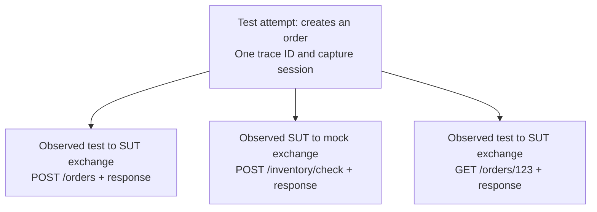

# Decision: one standard trace per test attempt

Date: 2026-09-27  
Status: **accepted direction; implementation pending**

This records the agreed product direction. It does not describe functionality
already shipped. The concrete API and field names below are the recommended
implementation contract for the [implementation handoff](otel-implementation-plan.md).
See [adoption notes](otel-adoption.md) for what teams will need to configure.

## Decision and adoption goal

Replace `X-Phrond-Trace-Id` with W3C Trace Context (`traceparent` and `tracestate`),
using OpenTelemetry propagation and context APIs. Each test attempt has its own
root span, fresh trace ID, and Phrond capture session. Requests made by that test
are operations within its trace. A retry is a new attempt with a new trace.

Teams retain their existing tests, HTTP clients, assertions, SUT, and mocks.
Phrond-specific integration belongs in the test harness and routing configuration.
Do not require production application code to forward a Phrond-specific ID.
Existing SUT instrumentation can supply standard propagation; applications
without it can still use isolated or sequential capture.

- Remove generation, injection, and correlation using `X-Phrond-Trace-Id`.
  Do not add a permanent compatibility mode for that header.
- Keep internal test-case, session, and flow IDs. `X-Phrond-Session-Id` may remain
  as an optional test-to-proxy selector; strip it before forwarding as today.
  The SUT never needs to propagate it.
- Keep `phrond.http` as an optional convenience. A special HTTP client must not
  become the required adoption path.
- Keep payload capture, body limits, redaction, assertions, strict OpenAPI
  validation, schema generation, and report/export functionality.
- Require no collector, exporter, telemetry backend, or instrumentation in the
  mock server. Phrond records traffic regardless of trace sampling decisions.
- Keep application and mock lifecycle/configuration outside Phrond.

## What a test trace means

A trace groups related operations. A span is one operation in that trace. The
root span represents the test attempt, including its name, timing, and outcome.
HTTP client instrumentation creates request spans under that root and puts their
context in standard headers. A correctly instrumented SUT continues the trace
when it calls a dependency. Phrond observes both sides and attaches payloads.



The diagram shows membership in the test, not proven request-to-request ancestry.
A response belongs to its captured request/response exchange; it does not need
to echo trace headers. SUT internals are not automatically visible to the proxy.

There are two distinct questions:

1. **Test ownership:** a registered trace identifies the test that owns a call.
   This supports concurrent tests when propagation reaches the captured calls.
2. **Request parentage:** which inbound SUT request caused a dependency call?
   Several inbound requests can share the test trace. Trace equality alone does
   not identify one parent, and the outbound header's span ID is often a SUT
   client span whose ancestry Phrond has not seen.

Never map a trace to just one inbound flow or choose the last flow with that
trace. Report unknown/ambiguous ancestry honestly. Receiving the SUT's exported
spans could add precise ancestry later; implementing an OTLP receiver or full
trace backend is outside this work.

## Test lifecycle and recommended API contract

Extend `POST /v1/setupTest` with an optional `trace_context` object. Example
addition to the existing payload (other required schema/dependency fields omitted):

```json
{
  "name": "creates an order",
  "explicit_session": true,
  "trace_context": {
    "traceparent": "00-4bf92f3577b34da6a3ce929d0e0e4736-00f067aa0ba902b7-00",
    "tracestate": ""
  }
}
```

This is the serialized **test root span's context**. The span ID encoded in this
header identifies the test span; it is not an invented parent of the root span.
Subsequent instrumented HTTP requests normally have different span IDs and the
same trace ID. Validate through standard propagation APIs, including nonzero IDs.
Reject invalid registration with 400 and trace reuse/duplicate ownership with 409.
Return the accepted context with the existing session response.

1. The adapter starts a real root span in its own per-test context. It must get
   valid IDs even if the process has no preconfigured OTel SDK/exporter.
2. Register the root context with the capture session **before test traffic**.
3. Run the test in that active context; keep the existing HTTP client interface.
4. Resolve each request's owning session at ingress, before upstream selection.
   Bind that owner to the exchange until recording completes.
5. The test awaits expected HTTP/background work. Teardown stops admission to
   that session, drains accepted exchanges with a bounded timeout, validates and
   writes the artifact, and then ends the root span with the final outcome.
6. Preserve the original test error if teardown also fails. A schema/assertion
   failure must also appear in the test/root outcome.

Retain the existing serial default: one implicit session can capture unlabeled
traffic. A traced test may use this fallback. Shared-runtime parallel adapters
must use `explicit_session: true` and independently scoped test contexts.
Existing API callers may omit `trace_context` and keep serial/explicit capture.

## Context and routing rules

- Preserve valid incoming `traceparent` and `tracestate`; never overwrite an
  existing trace merely to force it into the current test. Do not force sampling.
- On test-to-SUT ingress, if context is missing/invalid and a test owner is
  independently established, use that test's registered root context as a fallback.
  Mark this as injected context; it does not establish a distinct HTTP client span.
  Determine `test_correlation` from the original ingress evidence, before injection.
  Never preserve orphaned `tracestate` when replacing invalid context. Untraced
  legacy sessions can remain untraced. Do not inject a test trace into an untraced
  dependency request to make it appear that the SUT propagated context.
- Resolve session selectors from the explicit session URL, optional session
  header, and registered trace ID. If they identify different sessions, reject
  before forwarding (409); do not choose an upstream arbitrarily.
- With no explicit selector, a live registered trace selects its session. If no
  trace owner exists, fallback is permitted only for the single implicit session
  in serial/isolated mode. Do not use a default fallback while other sessions
  are active; ambiguous shared-runtime traffic receives a useful 409.
- A known closed trace must never fall through into a newer implicit session.
  Retain closed-trace tombstones until runtime shutdown; clear all routing/index
  state on shutdown. Bind in-flight exchanges at ingress, not at response finish.
- An unregistered valid trace may be captured under an independently selected
  serial/explicit session, but preserve it and diagnose the mismatch with the
  test trace. Do not silently register arbitrary foreign traces as test roots.
- Traced sessions return the stable dependency URL
  `/__phrond/dep/<asset-id>` even when explicit, allowing a shared SUT to be
  configured once. Resolve the trace owner **before** looking up that session's
  dependency upstream/schema. Keep session-scoped dependency URLs for explicitly
  isolated, untraced clients and as an explicit selector.
- One proxy runtime has one configured reverse SUT target for this release.
  Reject changes to that target while sessions are active; parallel tests with
  different SUT targets use separate runtimes. Avoid a new multi-SUT router.
- Legacy `/v1/testcases/start` capture and session-based capture must not run at
  the same time on one runtime. Preserve the legacy API in isolation, with ownership
  also bound at ingress; its global recorder must not duplicate session captures
  or attribute a late exchange to a later legacy test case.

Apply context/ownership handling consistently to ordinary HTTP reverse/forward
capture and decrypted HTTPS MITM requests. Preserve existing forwarding routes;
do not broaden arbitrary forward-proxy traffic into dependency discovery.
Opaque CONNECT passthrough cannot inspect trace headers or payloads.

## Artifact and report contract

Keep the current artifact version with additive optional fields; old artifacts
must load, including historical custom-format `trace_id` values. Do not interpret
old opaque IDs as W3C IDs or rewrite historical evidence.

Recommended additions:

| Location | Field | Meaning |
| --- | --- | --- |
| `testcase` | `trace_id`, `root_span_id` | Registered test root identifiers. |
| flow | existing `trace_id` | Actual standard trace on the captured request for new captures. |
| flow | `request_span_id` | Sender span ID from the request's `traceparent`; not necessarily a Phrond span or direct inbound parent. |
| flow | `trace_context_source` | `received` or `injected`; omitted when no valid context exists. |
| flow | `test_correlation` | `trace`, `explicit_session`, or `active_session`, according to the ownership evidence. |
| flow | `parent_correlation` | `trace_unique`, `timing`, `ambiguous`, or `unmatched`. |
| flow | existing `parent_flow_id` | Optional selected inbound flow; never populate for ambiguous/unmatched results. |

`trace_unique` means a single eligible inbound candidate in the same registered
test trace, not proof of internal SUT ancestry. The dependency must have carried
that trace on arrival, and its candidate parent must have started no later than
the dependency. With multiple eligible same-trace candidates, only a single
timing-overlap candidate may supply a `timing` inference. Without propagated
context, use timing candidates within the owning test. Multiple overlap candidates
are `ambiguous`; zero candidates are `unmatched`. Do not pick the latest-started
request to hide ambiguity, infer a future request as the cause, or override an
explicit conflicting trace with timing.

Reports show test membership and correlation evidence separately, with payloads
visible even when parentage is unknown. Include trace/root metadata in per-test
report output; retain attempt identities even when aggregate reports group names.
Raw captured headers remain evidence subject to normal redaction. Do not replay
stale `traceparent`, `tracestate`, or Phrond session headers in executable Postman
or workflow requests. Pact already filters tracing headers; preserve that behavior
and keep trace IDs out of interaction fingerprints and contract deduplication.

## Scope and limitations

- First deliver core context/session/correlation changes and the existing Node
  SDK integration. Then deliver tested Jest support and a small Go test helper.
  All are required for the target adoption experience; do not call it complete
  when only the proxy understands headers.
- No application source change is required specifically for Phrond. Enabling
  previously absent SUT instrumentation is optional, not an adoption prerequisite.
- Without working propagation, use one active test per isolated SUT/capture path.
  Parallel workers can each own a path; serialize SUT requests within it if timing
  parentage is needed. Isolation includes outbound routing, not just inbound ports.
- Test-only instrumentation cannot repair missing SUT propagation. It also cannot
  expose direct handler calls or mocks that intercept HTTP before it reaches Phrond.
- No automatic capture of arbitrary work after test completion. A drain timeout
  must produce an explicit incomplete-capture failure/diagnostic, never silent
  reassignment or a supposedly complete passing artifact.
- Remove the old custom trace feature at release, update examples and migration
  notes, and keep old artifacts readable. No unrelated transport/RPC expansion.

## References

- [W3C Trace Context](https://www.w3.org/TR/trace-context/)
- [OpenTelemetry context propagation](https://opentelemetry.io/docs/concepts/context-propagation/)
- [OpenTelemetry tracing API: root and child spans](https://opentelemetry.io/docs/specs/otel/trace/api/)
- [JavaScript propagation](https://opentelemetry.io/docs/languages/js/propagation/)
- [Go HTTP transport instrumentation](https://pkg.go.dev/go.opentelemetry.io/contrib/instrumentation/net/http/otelhttp#NewTransport)
