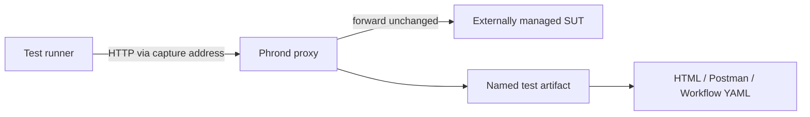

# Capture and reporting design

## Product boundary

Phrond records traffic initiated by a test and handled by its system under
test. It owns:

- an HTTP/HTTPS capture proxy;
- isolated, named per-test capture sessions;
- bounded request/response recording and redaction;
- optional OpenAPI validation;
- deterministic YAML artifacts and aggregate reports.

It does not own application lifecycle, application configuration, dependency
routing, mocks, fixtures, or assertion APIs. Consumers can use WireMock,
Spring Boot test integrations, containers, deployed environments, or any other
tool independently.

## Data flow

Each recorded flow has `channel: test_to_sut`, the request and response,
timing, trace ID, shape fingerprint, and any upstream `transport_error`.

## Consumer lifecycle

1. External orchestration starts and configures the SUT.
2. Phrond starts its proxy and points it at the SUT base URL.
3. The test creates a named session.
4. Test traffic is sent through Phrond's returned `sut_url`.
5. Teardown records pass/fail, validates schemas, and writes the artifact.
6. Suite teardown generates aggregate reports and stops Phrond.

The JavaScript `createNodeTestSuite` facade pushes steps 2, 3, 5, and 6 behind
test-runner hooks while leaving step 1 explicitly outside Phrond.

## Fidelity requirements

- Forward complete bytes even when retained artifact bodies are bounded.
- Preserve multi-value headers, trailers, binary bodies, compression metadata,
  status, timing, and upstream errors.
- Return a deterministic HTTP 502 for upstream failures on plain, reverse, and
  MITM paths while recording the original error.
- Keep artifact ordering and fingerprints deterministic.
- Skip only body schema validation when a body is truncated.

## Artifact and reporting contract

YAML is the canonical per-test artifact. Postman JSON and Open Workflow YAML
are derived exports, not storage formats. Reports cover provided SUT operations
that were exercised or not covered and include captured examples grouped by
test name.
