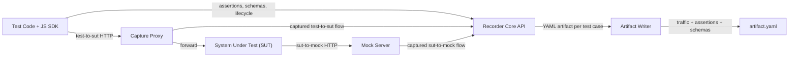

# Testing Tool Requirements and Solution Design

Date: 2026-02-04 (updated 2026-07-09)
Owner: TBD
Status: Draft

## 1) Overview
We are building a testing tool for microservice isolated black-box tests. The system provides a mock server and a capture proxy so tests can run against a real SUT while recording all HTTP traffic between:
- Tests -> SUT (via reverse-capture proxy)
- SUT -> Mock server (declared downstream dependencies)

**Ultimate product goal:** capture the network API expectations of dependent
systems during ordinary black-box tests **without changing how teams work**.
Example: Service A's API calls Service B then Service C; a test on Service A
mocks B and C. The proxy captures A's implemented requests/responses, and the
mock server captures the assumptions baked into the B/C mocks. A later
server-side component consumes these artifacts to detect integration errors
proactively (e.g. a provider change that breaks a consumer's recorded
assumption) — see §11a. The server side is intentionally deferred; the recorder
must capture everything it will need, passively.

Primary output is a single YAML artifact per test case that captures:
- Request/response traffic on both channels, with dependency attribution and
  causality links between them
- The mock assumptions (match rules + response contracts) and the fields the
  test depends on
- Producer/asset identity and references to OpenAPI specs

The system should stay focused on HTTP/HTTPS in v1.

## 2) Goals
- **Zero workflow change for teams**: declare each dependency once with a stable
  `asset_id`, inject its stable mock URL into the SUT at startup, call the SUT
  through the reverse-capture proxy with any HTTP client. No per-test rewiring,
  no proxy client configuration, no CA trust for HTTP, no mandatory specs.
- Produce a YAML artifact per test case that is deterministic, diffable, and
  merge-safe — sufficient for a future broker to detect breaking changes
  without any further team input.
- Capture HTTP/HTTPS traffic for two channels:
  - `test_to_sut`
  - `sut_to_mock`
- Attribute every `sut_to_mock` flow to a declared dependency (`asset_id`) and
  to the `test_to_sut` request that caused it (`parent_flow_id`).
- Capture the consumer's assumptions for built-in mocks: the mock stub contract
  (`mock_stub`) and the response fields the test depends on
  (`consumed_fields`). External mocks retain observed traffic and source
  metadata without fabricating provider-specific stub details.
- Attach OpenAPI schema references for contract comparison (optional,
  progressive enrichment).
- Provide a JavaScript SDK that test code uses to orchestrate test cases.
- Minimal provider burden (consumer-driven), similar intent to Pact but without
  provider-side setup or contract authoring.

## 3) Non-Goals (v1)
- Full service virtualization beyond deterministic HTTP responses (e.g., streaming SSE or WebSockets).
- Persistent mock state or complex data stores.
- UI for viewing artifacts (CLI tooling acceptable in v1).

## 4) Functional Requirements

### 4.1 Core Capabilities
1. Run a long-lived capture proxy and mock server per suite, with one isolated
   session per test case (zero-config correlation by default).
2. Declare downstream dependencies per session; each gets a stable asset-scoped
   mock base URL.
3. Register HTTP stubs (per dependency) with matching rules and literal responses.
4. Capture HTTP request/response pairs for both channels, with dependency
   attribution and causality links.
5. Record which mocked response fields the test depends on (`verify`).
6. Export a YAML artifact per test case.
7. Attach OpenAPI spec references to test cases (optional).
8. Validate captured traffic against attached specs for both SUT and mock channels.

### 4.4 Schema Validation Rules (v1)
- Schemas are optional. Without any, `schema_validation.status` is `skipped`
  (not failed) so teams can adopt before they have specs.
- When present, traffic is validated against schemas based on role:
  - `role: sut` validates `test_to_sut` traffic
  - `role: fake` validates `sut_to_mock` traffic (dependency schemas are
    registered with `role: fake` and the dependency's asset identity)
- OpenAPI schemas are validated for request + response bodies and headers.
- Validation results are stored in `artifact.schema_validation` with structured error objects.

Example (inline OpenAPI):

```json
{
  "name": "basic",
  "schemas": [
    {
      "id": "sut-openapi",
      "role": "sut",
      "type": "openapi",
      "source": {
        "type": "inline",
        "content": "openapi: 3.0.0\ninfo:\n  title: SUT\n  version: 1.0.0\npaths:\n  /process:\n    post:\n      responses:\n        \"200\": { \"description\": \"ok\" }\n"
      }
    }
  ]
}
```

### 4.5 Coverage Reporting (v1)
1. Provide a CLI helper that reads YAML/JSON artifacts after tests complete.
2. Report coverage from an API spec perspective:
   - Provided API specs: paths exercised and not covered.
   - Dependent API specs: paths faked and fields asserted.
3. Output should be machine-ingestable (YAML or JSON) for central reporting.

### 4.2 HTTPS Support
1. Proxy must support HTTPS via explicit proxy configuration.
2. Proxy must support HTTP CONNECT to establish tunnels.
3. Provide a local CA and MITM mode to decrypt HTTPS and record full bodies.
4. Provide a "pass-through" mode for environments where MITM is not allowed (only metadata capture).
5. Provide a way to trust the local CA for the test environment (documented steps).

### 4.3 Extensibility
1. Architecture must allow future protocol expansion without redesign.
2. Assertion paths should stay protocol-agnostic with an extensible path language.

## 5) Non-Functional Requirements
- Deterministic output ordering and stable IDs for diffing.
- Low overhead and minimal test latency (target < 50ms per request for proxy overhead).
- Safe handling of secrets via redaction rules.
- Clear failure modes and log output for diagnostics.
- Works on macOS and Linux CI environments.

## 6) Proposed Architecture

### 6.1 Components
1. **Recorder Core (service)**
   - Runs the proxy and mock server.
   - Captures traffic, evaluates assertions, and emits artifacts.

2. **JS SDK (test-side)**
   - Orchestrates test case lifecycle.
   - Registers stubs, declares assertions, sets schema references.

3. **Artifact Builder**
   - Aggregates traffic + assertions + metadata.
   - Writes per-test YAML to output directory.

4. **Coverage Reporter (CLI)**
   - Reads artifacts and attached schemas.
   - Produces a spec-coverage summary for provided and dependent APIs.

### 6.2 Key Decisions
- **Core language**: Go (recommended) for reliable HTTP/1.1 + HTTP/2 plumbing and MITM.
- **SDK language**: JavaScript (TypeScript recommended for SDK implementation).
- **Transport**: HTTP API between SDK and core service.
- **Proxy model**: reverse capture by default (tests call the proxy address as
  if it were the SUT); explicit forward proxy with CONNECT and MITM remains for
  traffic whose URL cannot be re-pointed.

### 6.3 Data Flow
1. SDK starts the suite runtime once (`startServer`): proxy (with SUT reverse
   target) + mock server.
2. The SUT is configured **once at startup** with the stable per-dependency mock
   URLs (`runtime.dependencyUrl(assetId)`).
3. Each test opens a session (`setupTest` — done automatically by `bindTest`),
   queues asset-scoped mock responses, and drives the SUT through the proxy
   with any HTTP client.
4. Requests are captured on both channels, attributed to the session
   (zero-config) and to the dependency (asset routing).
5. The test optionally records consumed fields (`verify`).
6. Session teardown finalizes the artifact: causality linking, fingerprints,
   consumed fields, schema validation (if schemas attached), redaction.

### 6.4 Architecture Diagram



### 6.4 Internal Interfaces (Go Sketches)
These are intentionally minimal and designed to keep HTTP-focused behavior.

```go
// ProtocolAdapter allows HTTP handling without rewriting core logic.
type ProtocolAdapter interface {
    Protocol() string // "http"
    CanHandle(raw *CapturedExchange) bool
    DecodeRequest(raw *CapturedExchange) (*RecordedMessage, error)
    DecodeResponse(raw *CapturedExchange) (*RecordedMessage, error)
    MatchStub(req *RecordedMessage, stubs []Stub) (*Stub, error)
}

// Proxy captures test->SUT traffic.
type Proxy interface {
    Start(ctx context.Context) (ProxyInfo, error)
    Stop(ctx context.Context) error
    SetMode(mode ProxyMode) error // mitm | passthrough
}

// MockServer serves downstream dependencies and records SUT->mock traffic.
type MockServer interface {
    Start(ctx context.Context) (MockInfo, error)
    Stop(ctx context.Context) error
    RegisterStub(stub Stub) error
    ClearStubs() error
}

// Recorder aggregates traffic and assertions into a test case.
type Recorder interface {
    StartCase(meta TestCaseMeta) (TestCaseHandle, error)
    RecordFlow(flow Flow) error
    RecordAssertion(assertion Assertion) error
    FinishCase(status string) (*Artifact, error)
}

// AssertionEngine evaluates recorded assertions against captured flows.
type AssertionEngine interface {
    Evaluate(artifact *Artifact) ([]AssertionResult, error)
}

// SchemaRegistry tracks OpenAPI schemas.
type SchemaRegistry interface {
    Add(ref SchemaRef) error
    Get(id string) (SchemaRef, bool)
}

// Redactor applies redaction rules before artifact export.
type Redactor interface {
    Apply(artifact *Artifact, rules []RedactionRule) error
}

// ArtifactWriter persists YAML to disk.
type ArtifactWriter interface {
    Write(artifact *Artifact) (string, error)
}
```

## 7) HTTPS Design Details

### 7.1 Modes
- **MITM Mode**: Proxy terminates TLS and re-encrypts to the target. Full capture and assertions available.
- **Pass-Through Mode**: Proxy forwards encrypted traffic without decryption. Only metadata captured.

### 7.2 CA Management
- Generate a local CA and issue dynamic per-host certificates.
- Store CA key/cert in a secure local directory.
- Provide SDK helper to output trust instructions.
- Allow overriding CA storage via `PHROND_PROXY_CA_DIR`.
- Artifact output directory can be overridden with `PHROND_ARTIFACT_DIR`.

### 7.3 Security/Redaction
- SDK accepts redaction rules (header and JSON field paths).
- Redaction applied before writing the YAML artifact.

## 8) Schema Strategy (OpenAPI)

### 8.1 OpenAPI (v1)
- Store schema references with SHA256 hash.
- Record OpenAPI version and file path (or inline source).
- An OpenAPI description of the artifact schema lives in `docs/artifact-openapi.yaml`.

## 9) SDK API Surface (JavaScript)

The implemented surface (see `sdk/js/README.md` for details):

### 9.1 Core Lifecycle
- `startServer({ baseUrl, proxy, mockServer, schemas, dependencies, sutBaseUrl, strictSchema, ... })`
- `runtime.setupTest({ name, tags, meta, dependencies, sutSchemas, fakeSchemas, recordTraffic, explicitSession })`
- `runtime.teardownTest({ status })`
- `runtime.killServer()`
- `bindTest(runtimeOrGetter, testFn)` — framework adapter: auto session per
  test, truthful pass/fail artifact status.

### 9.2 Dependencies and Mock Responses
- `runtime.dependencyUrl(assetId)` — stable base URL to inject into the SUT.
- `runtime.queueResponse({ id, assetId, default, match, response })`
- `runtime.listQueued()` / `runtime.listResponded()` / `runtime.getResponse(id)`

### 9.3 Expectation Capture
- `runtime.verify(id, fields)` — record the mocked response fields the test
  depends on (`consumed_fields`).

### 9.4 Test Traffic and Reporting
- `runtime.http.get/post/postJson/request(...)` — reverse-capture by default;
  per-request `sutBaseUrl` targets another service via forward proxy. Any HTTP
  client pointed at `runtime.sutUrl` works equally.
- `runtime.report({ artifactsDir, sutName, ... })`

## 10) YAML Artifact Format (Draft)

```yaml
version: 1
testcase:
  id: "tc-20260204-001"
  name: "create order returns 201"
  started_at: "2026-02-04T19:22:18Z"
  finished_at: "2026-02-04T19:22:19Z"
  tags: ["orders", "happy-path"]

environment:
  sut_base_url: "http://sut:8080"
  proxy_listen: "http://127.0.0.1:18080"
  mock_base_url: "http://127.0.0.1:19090"

schemas:
  - id: "sut-openapi"
    role: "sut"
    type: "openapi"
    source:
      type: "file"
      path: "specs/sut.yaml"
      sha256: "9a0b...f1"
    openapi_version: "3.2.0"

traffic:
  - id: "flow-1"
    protocol: "http"
    channel: "test_to_sut"
    trace_id: "phtr-1770000000-1"
    fingerprint: "418beb33ffdf23c6"
    started_at: "2026-02-04T19:22:18.120Z"
    duration_ms: 42
    request:
      method: "POST"
      url: "http://sut:8080/orders"
      headers:
        content-type: ["application/json"]
      body:
        encoding: "utf8"
        text: "{\"sku\":\"ABC\",\"qty\":1}"
    response:
      status: 201
      headers:
        content-type: ["application/json"]
      body:
        encoding: "utf8"
        text: "{\"id\":\"o-123\"}"
    assertion_ids: ["a-1"]
  - id: "flow-2"
    protocol: "http"
    channel: "sut_to_mock"
    asset_id: "inventory-service"
    parent_flow_id: "flow-1"
    fingerprint: "1d202cfddab85b59"
    matched_stub_id: "inventory-check"
    consumed_fields: ["body.available"]
    started_at: "2026-02-04T19:22:18.140Z"
    request:
      method: "GET"
      url: "/items/ABC"
    response:
      status: 200
      body:
        encoding: "utf8"
        text: "{\"sku\":\"ABC\",\"available\":true}"
    mock_stub:
      id: "inventory-check"
      source: "queued"
      matched_on: ["method", "path"]
      match:
        method: "GET"
        path: "/items/ABC"
      response_template:
        status: 200
        body: "{\"sku\":\"ABC\",\"available\":true}"

assertions:
  - id: "a-1"
    channel: "test_to_sut"
    phase: "response"
    field: "body.id"
    path_lang: "jsonpath"
    operator: "exists"
    result: "pass"

redactions:
  - field: "request.headers.authorization"
    rule: "mask"
```

Notes:
- The artifact also carries broker-oriented fields documented in §11a: top-level
  `producer`, per-schema `asset_name`/`asset_id`/`asset_sha`, per-`sut_to_mock`-flow
  `mock_mode`, optional `mock_stub`/`unmatched`/`transport_error`, HTTP trailers,
  and `body.content_encoding`. The authoritative schema is
  `docs/artifact-openapi.yaml`.
- For binary payloads, use `encoding: "base64"` and store `body.bytes`.
- The current encoder writes JSON (valid YAML 1.2) for deterministic output without external YAML dependencies.
- Assertion results default to `recorded` when the SDK captures a check without evaluation.
- The core currently evaluates `equals` and `exists` for `jsonpath`, `header`, and `status` assertions at test case finish.

## 11) Implementation Task List

### Phase 1: Core Architecture (HTTP/HTTPS)
1. Define YAML schema and data model for artifacts.
2. Publish OpenAPI schema for the artifact (`docs/artifact-openapi.yaml`).
3. Implement Go core service skeleton (config, logging, test case lifecycle).
4. Implement HTTP capture proxy (reverse capture + explicit proxy with CONNECT).
5. Implement MITM mode with local CA generation and per-host certs.
6. Implement mock server with asset-scoped stub matching and literal responses.
7. Implement traffic recorder and artifact builder.
8. Implement redaction pipeline.

### Phase 2: JavaScript SDK
1. Create JS/TS SDK package structure.
2. Implement SDK calls that talk to core service.
3. Implement assertion recording and result capture.
4. Add schema attachment utilities.
5. Add CA and proxy helper utilities.

### Phase 3: Developer Experience
1. Add CLI for initializing and debugging test runs.
2. Add docs for HTTPS trust setup (macOS, Linux, CI).
3. Provide sample test integration (Jest + Mocha).

### Phase 4: Protocol Expansion (future)
1. Define protocol adapter interfaces in core service.
2. Add artifact fields for additional protocol metadata if needed.
3. Add schema registry support for future schema types.
4. Add placeholder SDK calls for future protocol-specific stubs and assertions.

## 11a) Central Broker Direction ("stealth reverse-Pact")

The strategic goal is a Pact-like contract system that requires **no change to how
teams write tests**. Teams keep writing black-box tests against a real SUT with
mocked dependencies; the recorder passively captures everything a future central
broker needs. The broker is intentionally **not built yet** — the priority is to
make the recorder's capture lossless and self-identifying so the broker can later
be bolted on as a pure read-side consumer of artifacts.

Key concept: a consumer's mock stub *is* the contract ("what I assume my
dependency does"). The broker joins a consumer's faked dependency to the provider
that owns it and detects drift between the modelled assumption and provider truth.

### Identity (auto-detected, zero team effort)
Captured automatically by `internal/identity` (PHROND_* env → GitHub Actions →
GitLab CI → local git), so artifacts are always self-identifying:
- `artifact.producer`: `repo`, `commit_sha`, `branch`, `build`, `source`.
- Per schema (`schemas[].`): `asset_name`, `asset_id`, `asset_sha`.
  - `asset_id` is the **stable cross-repo join key**: a consumer's `role: fake`
    asset is joined to the provider's `role: sut` asset with the same id. This is
    the one bit of cross-team coordination required (a shared asset-id naming
    convention) — it is not contract authoring.
  - `asset_sha` defaults to `source.sha256`; `asset_name` defaults to the id.

### First-class dependencies (asset routing)
The SUT's downstream services are declared per session
(`setupTest({dependencies: [{asset_id, asset_name, schema}]})`). Each dependency
gets its own stable mock base URL (`.../__phrond/dep/<asset_id>`), stubs are
scoped to a dependency (`Stub.AssetID`), and captured flows carry `asset_id` as
**ground truth** — attribution never relies on OpenAPI route inference, so two
dependencies with overlapping paths (both exposing `GET /health`) never collide.
A dependency's schema is registered as `role: fake` with the asset identity.

### Correlation (zero-config by default)
Session URLs carry no session component: unlabeled traffic (mock and proxy
channels) is attributed to the single active session, tracked as a "default
session" on both components. Only one zero-config session may be active at a
time (second `setupTest` → 409). Parallel suites opt into
`explicit_session: true` (session-prefixed URLs / `X-Phrond-Session-Id` header).
Net effect: teams inject N stable dependency URLs once at SUT startup — no
per-test rewiring, no forwarding shims.

### Reverse capture (test→SUT)
The proxy listener serves three request styles: plain requests are
reverse-proxied to the configured SUT target (`startServer` `proxy.target_url`,
set automatically by the SDK from `sutBaseUrl`); absolute-URI forward-proxy
requests and CONNECT/MITM tunnels still work. Tests point any HTTP client at
`sut_url` — no proxy configuration and no CA trust needed for HTTP. MITM remains
the escape hatch for traffic whose URL cannot be re-pointed.

### Assumption capture (the contract)
Each built-in matched `sut_to_mock` flow carries `mock_stub`:
- `match` + `matched_on` (which criteria constrained it) + `source`
  (`queued` = hand-written by the test; `recorded` = captured from a fallback
  upstream — different trust levels for a broker).
- `response_template`: the stub's configured response (`status`/`headers`/`body`),
  the stable contract — identical to the rendered `response` on the flow since
  responses are literal (see below).
- `unmatched: true` flags a SUT call no stub modelled (an undeclared dependency).
The stub is snapshotted at match time in `mock.Exchange.MatchedStub` because
matched stubs are consumed (removed) from the registry on match.

An external dependency instead carries `mock_mode: external` with the observed
request/response. It has no `mock_stub` or `unmatched` claim because a generic
gateway cannot infer the external provider's configured match rule. Connection
and TLS failures retain `transport_error` alongside a recorded 502 response.

### Consumption, causality, dedup
- `consumed_fields` (via `POST /v1/verify` / SDK `runtime.verify(id, fields)`):
  which mocked response fields the test depends on — distinguishes breaking
  changes from changes to ignored fields, avoiding broker false positives.
- `trace_id` / `parent_flow_id`: the proxy injects `X-Phrond-Trace-Id` on every
  test→SUT request; if the SUT propagates it, downstream calls link exactly.
  Otherwise time-window nesting (with 1ms rounding slack) links each
  `sut_to_mock` flow to the `test_to_sut` request that caused it. This yields
  the call graph: which provided operation depends on which dependency
  operations.
- `fingerprint`: stable hash of interaction shape (channel|method|path|status|
  JSON key/type structure) for cross-run and cross-repo dedup.

### Schemas are optional
`setupTest` no longer requires schemas; without any, `schema_validation.status`
is `skipped` (not failed). Adoption first, rigor second — specs enrich
validation when attached. `source.sha256` (and thus `asset_sha`) is computed at
capture time for file/inline schemas.

### Mock responses are literal (no templating)
The mock server returns `response.body` / `response.body_file` verbatim — there
is **no** template/render engine (removed 2026-06-23 along with the `sprig`,
`cel-go`, and `gofakeit` deps and `setVar`/`getVar` session state). This is
deliberate: literal responses are deterministic, so artifacts are diffable and a
broker sees no false drift. Tests compute the exact bytes they expect; ordered
sequences use the response stack. For a long-lived mock against a running dev
environment, `examples/persistent-mock` shows a single-file server built on the
default matcher (static `default: true` routes + optional upstream fallback).

### Body fidelity
`Body.content_encoding` records the original wire encoding when a gzip/deflate
payload was transparently decompressed before storage, so bodies stay diffable
(see `bodyFromHTTP` in `internal/app/recorder.go`). Binary/undecodable payloads
fall back to base64.

### Capture-fidelity roadmap
The remaining gaps before the recorder is "perfect" are specified in detail —
problem, code locations, implementation steps, acceptance criteria — in
`docs/roadmap-capture-fidelity.md`. Summary:
- **B3**: HTTP/2 support (upstream + h2c + MITM ALPN) and RPC
  (gRPC/gRPC-Web/Connect) mocking + capture built on Buf Connect
  (`connectrpc.com/connect`) with a raw-bytes codec — **schema-less**: no
  `.proto` files, generated types, or server reflection; payloads stored as
  opaque bytes (decoding would require descriptors and stays out of scope).
  Plus WebSocket/SSE upgrade detection with byte-tunnel passthrough, and the
  negotiated protocol recorded per flow.
- **B4 (completed 2026-07-25)**: bounded streaming capture defaults to 4 MiB
  per body and records `truncated`/`original_bytes` without truncating traffic
  delivered to clients or upstreams. Decompression is independently bounded,
  and truncated bodies skip body-only schema validation.
- **B5 (completed 2026-07-24)**: MITM upstream errors synthesize the same
  recorded 502 as the plain/reverse path.
- ~~**B6**: deterministic renders~~ — resolved by removing the template engine;
  literal responses are deterministic by construction.
- ~~**D**: session-threading friction~~ — resolved by zero-config correlation
  (see "Correlation" above): stable unprefixed URLs, active-session attribution,
  explicit sessions only for parallel suites.

## 12) Risks and Open Questions
- How will the SUT be configured to trust the local CA in CI?
- Do we need WS/SSE support in v1, or can we defer?
- What is the redaction policy for PII by default?
- Should the mock server support deterministic delays and error injection in v1?
