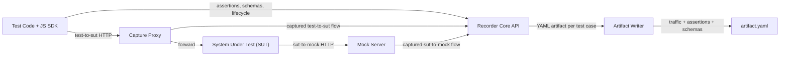

# Testing Tool Requirements and Solution Design

Date: 2026-02-04
Owner: TBD
Status: Draft

## 1) Overview
We are building a testing tool for microservice isolated black-box tests. The system provides a mock server and a capture proxy so tests can run against a real SUT while recording all HTTP traffic between:
- Tests -> SUT (via proxy)
- SUT -> Mock server (downstream dependencies)

Primary output is a single YAML artifact per test case that captures:
- Request/response traffic on both channels
- Field-level assertions made by the test
- References to OpenAPI specs and (later) Protobuf schemas

The system should be extensible to support gRPC/protos later, while implementing HTTP/HTTPS in v1.

## 2) Goals
- Produce a YAML artifact per test case that is deterministic, diffable, and merge-safe.
- Capture HTTP/HTTPS traffic for two channels:
  - `test_to_sut`
  - `sut_to_mock`
- Support explicit, field-level assertions and link them to captured traffic.
- Attach schema references (OpenAPI now, Protobuf later) for contract comparison.
- Provide a JavaScript SDK that test code uses to orchestrate test cases and record assertions.
- Minimal provider burden (consumer-driven), similar intent to Pact but without provider-side setup.

## 3) Non-Goals (v1)
- Protobuf decoding and rich gRPC schema-aware assertions (planned for v2).
- Full service virtualization beyond deterministic HTTP responses (e.g., streaming SSE or WebSockets).
- Persistent mock state or complex data stores.
- UI for viewing artifacts (CLI tooling acceptable in v1).

## 4) Functional Requirements

### 4.1 Core Capabilities
1. Start and stop a capture proxy per test case.
2. Start and stop a mock server per test case.
3. Register HTTP stubs with matching rules and responses.
4. Capture HTTP and gRPC request/response pairs for both channels.
5. Record and evaluate field-level assertions in tests.
6. Export a YAML artifact per test case.
7. Attach OpenAPI or Protobuf spec references to test cases (required).
8. Register gRPC stubs with matching rules and responses (raw bytes).
9. Validate captured traffic against the provided specs for both SUT and mock channels.

### 4.4 Schema Validation Rules (v1)
- Tests must provide at least one schema via `schemas` when starting a test case.
- Traffic is validated against schemas based on role:
  - `role: sut` validates `test_to_sut` traffic
  - `role: fake` validates `sut_to_mock` traffic
- OpenAPI schemas are validated for request + response bodies and headers.
- Protobuf schemas validate gRPC method existence and message decoding.
- Proto imports are supported via `source.import_paths` (relative to repo root or absolute paths).
- Descriptor sets are supported for complex protobufs: set `source.format: descriptor` and provide `source.path` or `source.url`.

### 4.2 HTTPS Support
1. Proxy must support HTTPS via explicit proxy configuration.
2. Proxy must support HTTP CONNECT to establish tunnels.
3. Provide a local CA and MITM mode to decrypt HTTPS and record full bodies.
4. Provide a "pass-through" mode for environments where MITM is not allowed (only metadata capture).
5. Provide a way to trust the local CA for the test environment (documented steps).

### 4.3 Extensibility for gRPC
1. Architecture must allow HTTP/2 and TLS MITM without redesign.
2. Artifact schema must have protocol discriminators (HTTP vs gRPC) and store raw bytes (implemented).
3. Schema references must include Protobuf descriptors for later decoding.
4. Assertion paths must be protocol-agnostic with an extensible path language.

## 5) Non-Functional Requirements
- Deterministic output ordering and stable IDs for diffing.
- Low overhead and minimal test latency (target < 50ms per request for proxy overhead).
- Safe handling of secrets via redaction rules.
- Clear failure modes and log output for diagnostics.
- Works on macOS and Linux CI environments.

## 6) Proposed Architecture

### 6.1 Components
1. **Recorder Core (service)**
   - Runs the proxy and mock server.
   - Captures traffic, evaluates assertions, and emits artifacts.

2. **JS SDK (test-side)**
   - Orchestrates test case lifecycle.
   - Registers stubs, declares assertions, sets schema references.

3. **Artifact Builder**
   - Aggregates traffic + assertions + metadata.
   - Writes per-test YAML to output directory.

### 6.2 Key Decisions
- **Core language**: Go (recommended) for reliable HTTP/1.1 + HTTP/2 plumbing, MITM, and future gRPC capture.
- **SDK language**: JavaScript (TypeScript recommended for SDK implementation).
- **Transport**: HTTP API between SDK and core service.
- **Proxy model**: Explicit forward proxy with CONNECT and MITM for HTTPS.

### 6.3 Data Flow
1. SDK starts a test case and launches the proxy + mock server.
2. Test configures SUT to use the proxy for outbound calls, and SUT downstream URLs are pointed at the mock server.
3. Requests are captured on both channels.
4. Test records assertions via SDK.
5. SDK finalizes test case, triggers artifact generation.
   - The core service stops the proxy and mock server after test case completion.

### 6.4 Architecture Diagram



### 6.4 Internal Interfaces (Go Sketches)
These are intentionally minimal and designed to keep HTTP now while allowing gRPC later.

```go
// ProtocolAdapter allows HTTP today and gRPC later without rewriting core logic.
type ProtocolAdapter interface {
    Protocol() string // "http", "grpc"
    CanHandle(raw *CapturedExchange) bool
    DecodeRequest(raw *CapturedExchange) (*RecordedMessage, error)
    DecodeResponse(raw *CapturedExchange) (*RecordedMessage, error)
    MatchStub(req *RecordedMessage, stubs []Stub) (*Stub, error)
}

// Proxy captures test->SUT traffic.
type Proxy interface {
    Start(ctx context.Context) (ProxyInfo, error)
    Stop(ctx context.Context) error
    SetMode(mode ProxyMode) error // mitm | passthrough
}

// MockServer serves downstream dependencies and records SUT->mock traffic.
type MockServer interface {
    Start(ctx context.Context) (MockInfo, error)
    Stop(ctx context.Context) error
    RegisterStub(stub Stub) error
    ClearStubs() error
}

// Recorder aggregates traffic and assertions into a test case.
type Recorder interface {
    StartCase(meta TestCaseMeta) (TestCaseHandle, error)
    RecordFlow(flow Flow) error
    RecordAssertion(assertion Assertion) error
    FinishCase(status string) (*Artifact, error)
}

// AssertionEngine evaluates recorded assertions against captured flows.
type AssertionEngine interface {
    Evaluate(artifact *Artifact) ([]AssertionResult, error)
}

// SchemaRegistry tracks OpenAPI and (future) Protobuf schemas.
type SchemaRegistry interface {
    Add(ref SchemaRef) error
    Get(id string) (SchemaRef, bool)
}

// Redactor applies redaction rules before artifact export.
type Redactor interface {
    Apply(artifact *Artifact, rules []RedactionRule) error
}

// ArtifactWriter persists YAML to disk.
type ArtifactWriter interface {
    Write(artifact *Artifact) (string, error)
}
```

## 7) HTTPS Design Details

### 7.1 Modes
- **MITM Mode**: Proxy terminates TLS and re-encrypts to the target. Full capture and assertions available.
- **Pass-Through Mode**: Proxy forwards encrypted traffic without decryption. Only metadata captured.

### 7.2 CA Management
- Generate a local CA and issue dynamic per-host certificates.
- Store CA key/cert in a secure local directory.
- Provide SDK helper to output trust instructions.
- Allow overriding CA storage via `PHROND_PROXY_CA_DIR`.
- Artifact output directory can be overridden with `PHROND_ARTIFACT_DIR`.

### 7.3 Security/Redaction
- SDK accepts redaction rules (header and JSON field paths).
- Redaction applied before writing the YAML artifact.

## 8) Schema Strategy (OpenAPI + Protobuf)

### 8.1 OpenAPI (v1)
- Store schema references with SHA256 hash.
- Record OpenAPI version and file path (or inline source).
- An OpenAPI description of the artifact schema lives in `docs/artifact-openapi.yaml`.

### 8.2 Protobuf (v2)
- Store `.proto` paths or compiled descriptor set references.
- Record Protobuf package/service/method references for captured gRPC calls.

## 9) SDK API Surface (JavaScript)

### 9.1 Core Lifecycle
- `createHarness(config)`
- `startTestCase(name, meta)`
- `finishTestCase(status)`
- `getArtifact()`

### 9.2 Proxy and Mock
- `startProxy({ targetUrl, listen, mode })`
- `startMockServer({ listen })`
- `registerStub({ id, match, response, tags, schemaRef, operationId })`
- `clearStubs()`

### 9.3 Schemas and Assertions
- `setSchema({ role, type, source })`
- `assertField({ channel, phase, field, operator, expected })`
- `expectCall({ channel, match, times })`

### 9.4 HTTPS Utilities
- `getCaCertificate()`
- `setProxyMode({ mode })`

### 9.5 gRPC-Ready API (no-op in v1)
- `registerProto({ source, format, packageFilter })`
- `registerGrpcStub({ id, method, match, response, metadata, schemaRef })`
- `assertMessage({ channel, phase, field, operator, expected, pathLang })`

## 10) YAML Artifact Format (Draft)

```yaml
version: 1
testcase:
  id: "tc-20260204-001"
  name: "create order returns 201"
  started_at: "2026-02-04T19:22:18Z"
  finished_at: "2026-02-04T19:22:19Z"
  tags: ["orders", "happy-path"]

environment:
  sut_base_url: "http://sut:8080"
  proxy_listen: "http://127.0.0.1:18080"
  mock_base_url: "http://127.0.0.1:19090"

schemas:
  - id: "sut-openapi"
    role: "sut"
    type: "openapi"
    source:
      type: "file"
      path: "specs/sut.yaml"
      sha256: "9a0b...f1"
    openapi_version: "3.2.0"

traffic:
  - id: "flow-1"
    protocol: "http"
    channel: "test_to_sut"
    started_at: "2026-02-04T19:22:18.120Z"
    duration_ms: 42
    request:
      method: "POST"
      url: "http://sut:8080/orders"
      headers:
        content-type: ["application/json"]
      body:
        encoding: "utf8"
        text: "{\"sku\":\"ABC\",\"qty\":1}"
    response:
      status: 201
      headers:
        content-type: ["application/json"]
      body:
        encoding: "utf8"
        text: "{\"id\":\"o-123\"}"
    assertion_ids: ["a-1"]

assertions:
  - id: "a-1"
    channel: "test_to_sut"
    phase: "response"
    field: "body.id"
    path_lang: "jsonpath"
    operator: "exists"
    result: "pass"

redactions:
  - field: "request.headers.authorization"
    rule: "mask"
```

Notes:
- For binary or gRPC payloads, use `encoding: "base64"` and store `body.bytes`.
- Add `protocol: "grpc"` and a `grpc` section for gRPC calls later.
- The current encoder writes JSON (valid YAML 1.2) for deterministic output without external YAML dependencies.
- Assertion results default to `recorded` when the SDK captures a check without evaluation.
- The core currently evaluates `equals` and `exists` for `jsonpath`, `header`, and `status` assertions at test case finish.

## 11) Implementation Task List

### Phase 1: Core Architecture (HTTP/HTTPS)
1. Define YAML schema and data model for artifacts.
2. Publish OpenAPI schema for the artifact (`docs/artifact-openapi.yaml`).
3. Implement Go core service skeleton (config, logging, test case lifecycle).
4. Implement HTTP capture proxy (explicit proxy with CONNECT).
5. Implement MITM mode with local CA generation and per-host certs.
6. Implement mock server with stub matching and response templating.
7. Implement traffic recorder and artifact builder.
8. Implement redaction pipeline.

### Phase 2: JavaScript SDK
1. Create JS/TS SDK package structure.
2. Implement SDK calls that talk to core service.
3. Implement assertion recording and result capture.
4. Add schema attachment utilities.
5. Add CA and proxy helper utilities.

### Phase 3: Developer Experience
1. Add CLI for initializing and debugging test runs.
2. Add docs for HTTPS trust setup (macOS, Linux, CI).
3. Provide sample test integration (Jest + Mocha).

### Phase 4: gRPC Preparation (no execution)
1. Define protocol adapter interfaces in core service.
2. Add artifact fields for `protocol: grpc` and raw bytes.
3. Add schema registry support for Protobuf references.
4. Add placeholder SDK calls for gRPC stubs and assertions.

## 12) Risks and Open Questions
- How will the SUT be configured to trust the local CA in CI?
- Do we need WS/SSE support in v1, or can we defer?
- What is the redaction policy for PII by default?
- Should the mock server support deterministic delays and error injection in v1?
