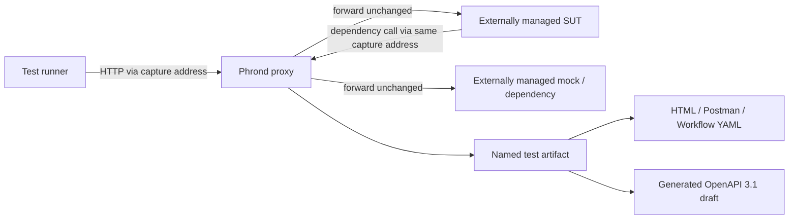

# Capture and reporting design

The accepted next tracing design is documented in
[one standard trace per test attempt](otel-test-tracing.md), with
[adoption notes](otel-adoption.md) and an
[implementation handoff](otel-implementation-plan.md). The runtime uses that trace model.

## Product boundary

Phrond records traffic initiated by a test and handled by its system under
test, plus outbound traffic that SUT sends to externally owned dependencies. It
owns:

- an HTTP/HTTPS capture proxy;
- external-only dependency forwarding on that same capture listener;
- isolated, named per-test capture sessions;
- bounded request/response recording and redaction;
- strict OpenAPI validation and opt-in OpenAPI bootstrapping;
- deterministic YAML artifacts and aggregate reports.

It does not own application lifecycle, application configuration, dependency
lifecycles, mocks, fixtures, or mock-server verification APIs. Consumers can use WireMock,
Spring Boot test integrations, containers, deployed environments, or any other
tool independently.

## Data flow

Inbound flows have `channel: test_to_sut`. Outbound flows have
`channel: sut_to_dependency`, a declared stable `asset_id`, and a
`parent_flow_id` linking them to the originating inbound flow. Both include the
request and response, timing, trace ID, shape fingerprint, and upstream
`transport_error` when applicable.

## Consumer lifecycle

1. External orchestration starts and configures the SUT and any mock servers.
2. Phrond starts its proxy and points it at the SUT base URL.
3. The test creates a named session and declares external dependency URLs and schemas.
4. Inbound and configured outbound traffic travel through Phrond's existing proxy.
5. Teardown records pass/fail, validates schemas, and writes the artifact.
6. Suite teardown generates aggregate reports and stops Phrond.

Consumers normally attach a SUT schema and a schema for every declared
dependency with no mode setting. Missing, unreadable, and invalid schemas fail
before the test session starts; captured violations in either direction fail
teardown. A consumer without a SUT schema can explicitly request generation,
which aggregates all completed suite artifacts into a reviewable OpenAPI 3.1
draft before shutdown. Generation never modifies a supplied schema.

The JavaScript `createNodeTestSuite` facade pushes steps 2, 3, 6, and 7 behind
test-runner hooks while leaving step 1 explicitly outside Phrond.

## Fidelity requirements

- Forward complete bytes even when retained artifact bodies are bounded.
- Preserve multi-value headers, trailers, binary bodies, compression metadata,
  status, timing, and upstream errors.
- Return a deterministic HTTP 502 for upstream failures on plain, reverse, and
  MITM paths while recording the original error.
- Keep artifact ordering and fingerprints deterministic.
- Skip only body schema validation when a body is truncated.

## Artifact and reporting contract

YAML is the canonical per-test artifact. Postman JSON, Open Workflow YAML, and
generated OpenAPI are derived exports, not storage formats. Reports cover
provided SUT and externally dependent operations that were exercised or not
covered and include correlated captured examples grouped by test name.
Generated OpenAPI models the provided SUT only, omits captured examples, and is
a bootstrap draft that must be reviewed before enforcement.
